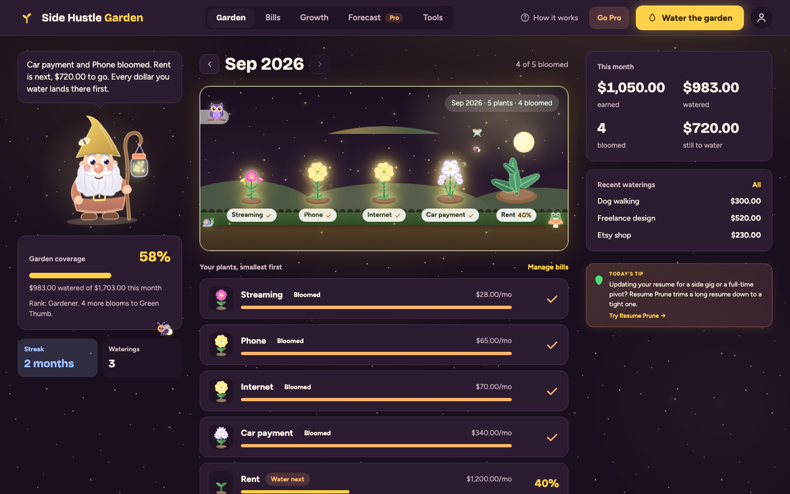
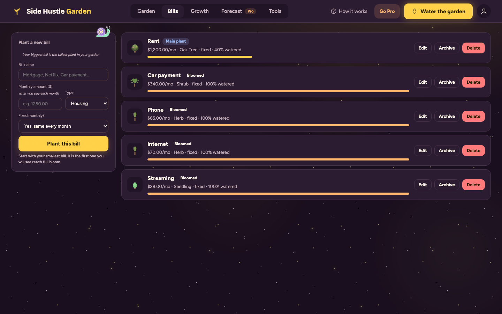
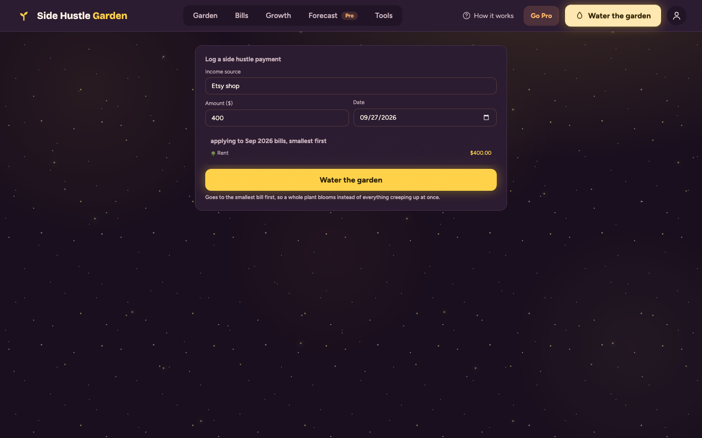

# Side Hustle Garden 🌱

**An income tracker for side hustlers that shows what your extra money actually pays for.** Your monthly bills are plants. Every side hustle payment you log waters them, smallest bill first, and a bill blooms once it's covered for the month. A lantern gnome keeps you company.

Don't want to host it yourself? Use the hosted version at **[sidehustlegarden.com](https://sidehustlegarden.com)**. It has a free plan, with no setup and no card. Or run your own copy with the code in this repo.



---

## What it does

| Tab | What you get |
|---|---|
| **Garden** | Every bill as a plant, how much of this month's bills your side income covered, and your recent waterings. |
| **Water** | Log a payment: where it came from, how much and the date. It shows which bills the money will cover before you save it. |
| **Bills** | Plant and edit your bills. Mark the ones that cost the same every month, and set the rest month by month. |
| **Growth** | How your coverage has moved month over month, with every watering on record. |
| **Forecast** | Pro. Where your bills and side hustle income land over the next 6 months. Part of the hosted version. On your own copy it stays locked. |

It never connects to your bank. You type in what you earned. Coverage starts fresh each month, and your history stays in Growth. It also works on your phone and has a full how-to guide built in.

<p>


</p>

---

## Two ways to use it

### 1. Use the hosted version (easiest)

Go to **[sidehustlegarden.com](https://sidehustlegarden.com)** and sign up. The free plan is the whole garden with no cap on bills or payments. Pro adds the 6-month cash flow forecast and CSV export. Paying for Pro there is also how you support the project.

### 2. Run your own copy

**What a copy gives you:** your copy runs the free plan for everyone. That's the whole garden, with no cap on bills or payments. Pro, with the forecast and CSV export, isn't sold on a copy. The **Go Pro** button opens a short note that Pro is part of the hosted version at sidehustlegarden.com, with no price and no checkout.

Side Hustle Garden runs on Cloudflare Workers with a D1 database. You'll need [Node.js](https://nodejs.org) 22 or newer. Trying it on your own computer needs no Cloudflare account. Putting it online needs one, and a free account is enough.

**Try it on your computer:**

```bash
git clone https://github.com/jensoltys/sidehustlegarden.git
cd sidehustlegarden
npm install
cp .dev.vars.example .dev.vars
```

Open the new `.dev.vars` file and put a long random string after `GARDEN_SESSION_SECRET=` (32 or more characters). `openssl rand -hex 32` prints a good one. Until that's set, sign up and log in answer "This server isn't set up yet".

```bash
npm run db:setup:local
npm run dev
```

Open `http://localhost:8787`. With `DEV_LOG_CODES=true` in `.dev.vars`, the 6-digit signup code and any password reset link print in your terminal, so you can test without setting up email. Running on a different port? Change `APP_URL` in `.dev.vars` to match, because the printed reset link uses it.

**To put it online:**

Create your database, then paste the `database_id` it prints into `wrangler.toml`:

```bash
npx wrangler d1 create side-hustle-garden
```

Set `APP_URL` and `EMAIL_FROM` in `wrangler.toml` to your live address and your sender, so the very first emails carry the right links. Then:

```bash
npm run db:setup:remote
npx wrangler secret put GARDEN_SESSION_SECRET
npx wrangler secret put RESEND_API_KEY      # signup codes and password resets
npm run deploy                              # runs the security scan, then deploys
```

Use `npm run deploy`, not `npx wrangler deploy`. Only the npm script runs the security scan first. A daily cleanup job runs at 09:17 UTC (the `crons` line in `wrangler.toml`) and clears out expired rate-limit records and old reset codes.

### Settings

| Setting | Needed? | What it's for |
|---|---|---|
| `GARDEN_SESSION_SECRET` | **Yes** | Signs logins. The app refuses to start a session without a 32+ character secret. |
| `APP_URL` | **Yes** | Your site's address. Links in emails point here, and so do the link-preview and canonical tags on every page. |
| `APP_NAME` | Optional | The app's name in alert and feedback webhook messages. Set in `wrangler.toml`. |
| `RESEND_API_KEY` + `EMAIL_FROM` | For a live site | Sends signup codes and password resets through [Resend](https://resend.com). If `EMAIL_FROM` is blank, emails go out from Resend's test sender, `onboarding@resend.dev`, which only delivers to the email on your own Resend account. Set it to an address on a domain you've verified in Resend. |
| `DEV_LOG_CODES` | Local testing only | Set to `true` to print signup codes and reset links in the terminal when `RESEND_API_KEY` is blank. Never set it on a live site. |
| `ALERT_WEBHOOK_URL` + `ALERT_TOKEN` | Optional | Get a message when the server hits an error. |
| `SIGNUP_WEBHOOK_URL` + `SIGNUP_WEBHOOK_SECRET` | Optional | Get a message on each new signup. |
| `FEEDBACK_WEBHOOK_URL` | Optional | Where the in-app feedback button sends messages. Blank hides the Feedback button. |

**The forecast and CSV export are Pro-only.** Pro is part of the hosted version, so on a copy they stay locked for everyone. The one function that decides who has Pro is `hasProAccess` in `src/worker.js`.

### Before you run it publicly

Replace these before you go public:

- [ ] `YOUR COMPANY NAME`, `YOUR BUSINESS ADDRESS` and the contact emails in `public/legal/`, the page footers, the privacy summary in `public/index.html` and `EMAIL_SENDER_LINE` in `src/worker.js` (it goes at the bottom of every email).
- [ ] `YOUR STATE` and `YOUR COUNTY` in `public/legal/terms.html` (governing law and courts).
- [ ] The source code link in the footers and in `public/legal/terms.html`, if you run a changed version (the AGPL asks you to offer your own code).
- [ ] The lines in `public/legal/` that depend on your setup: Cloudflare Web Analytics and the affiliate links in `privacy.html` and `do-not-sell.html`, and the line marked `EDIT THIS LINE` in `accessibility.html`.
- [ ] Section 4 of `public/legal/terms.html` (Paid plans). It says your site has no paid plan and takes no payments. Rewrite it if you add one.
- [ ] `YOUR-DOMAIN` in `public/robots.txt` (uncomment the Sitemap line once you have one).
- [ ] `public/.well-known/security.txt`: the `security@example.com` contact, the `example.com` address and the `Expires` date.
- [ ] `public/og.png`, the social share image. It shows sidehustlegarden.com in the corner. The tags that point to it use your `APP_URL`, so you only swap the picture.

Pro is part of the hosted version. On a copy, the **Go Pro** button opens a short note that Pro lives on sidehustlegarden.com. No price or checkout shows, so nobody pays for something that won't work on your copy.

**Tips and links that ship in the code.** The app shows a daily tip and a **Tools** drawer. Most of them link to other apps and posts by Jen Built It, the app's maker. Three are affiliate links and are labeled that way in the app: [OINK](https://oinkforinfluencers.com), [Levanta](https://levanta.io) and [Logie](https://mylogie.com). The tips are the `NUDGES` list in `public/app.js`, and the drawer is the `res-drawer` block in `public/index.html`. Swap in your own or delete them.

### Keep your copy as safe as sidehustlegarden.com

Your copy is built from the same source as sidehustlegarden.com, with the hosted site's own hookups turned into optional settings. So it gets the same protections: hashed passwords, a lockout after 5 wrong passwords, limits on signup-code guesses, daily caps on signup and reset emails, every other session signed out when a password changes, a reset link that stops working once it's used, and checks that block requests from other websites. A few of those depend on your setup:

- [ ] **Use a long random `GARDEN_SESSION_SECRET`.** The app won't log anyone in without one of 32+ characters. `openssl rand -hex 32` makes a good one.
- [ ] **Set up email before going live** (`RESEND_API_KEY` and `EMAIL_FROM`). Never set `DEV_LOG_CODES` on a live site.
- [ ] **Keep secrets out of git.** Store them with `npx wrangler secret put`, never in `wrangler.toml`. `.dev.vars` is already ignored.
- [ ] **Stay updated.** Security fixes made on sidehustlegarden.com get copied here. Click **Watch** at the top of this page to hear about them, then pull and redeploy.

Found a security problem? See [SECURITY.md](SECURITY.md).

---

## Built with

Side Hustle Garden is a Cloudflare Worker with a D1 database and a job that runs once a day. It uses Resend for signup codes and password resets, and the tests run on Node's built-in test runner.

## Tests

```bash
npm test                # unit tests plus the bill-archiving and start-month checks
npm run test:security   # scans for common security mistakes
```

## Made by

**Jen Soltys**. I build small apps that fix everyday annoyances at **[Jen Built It](https://jenbuiltit.com)** and write about building with AI at **[jen8n.com](https://jen8n.com)**.

If Side Hustle Garden helps you, the best support is a **[Pro plan on sidehustlegarden.com](https://sidehustlegarden.com)** or a ⭐ on this repo.

## Contributing

Bug reports and ideas are welcome in [Issues](../../issues). I'm not taking pull requests right now, which keeps the commercial license option possible. You're free to fork it and make it yours under the license below. See [CONTRIBUTING.md](CONTRIBUTING.md) and the [code of conduct](CODE_OF_CONDUCT.md).

**Getting help:** self-hosted copies are community-supported. You run your copy, so you handle its setup, updates, backups and security. [SUPPORT.md](SUPPORT.md) says where to ask.

## License

[AGPL-3.0](LICENSE). You can use, change and share Side Hustle Garden. If you run a changed version as a website for other people, you have to share your changed code under the same license.

### Commercial license

Want to build Side Hustle Garden into a product without sharing your code, or run a changed version for customers without publishing your changes? You can buy a commercial license that replaces the AGPL terms for your business. Email **hello@jenbuiltit.com** with what you're building.

Side Hustle Garden isn't affiliated with or endorsed by any of the services named in it. Amazon and the Amazon logo are trademarks of Amazon.com, Inc. or its affiliates. OINK, Levanta, Logie, Etsy and every other product name here are trademarks of their respective owners.

## Trademarks

The license covers the code, not the name. "Side Hustle Garden", its logo and its look aren't licensed for your own product. If you run a changed copy for other people, give it your own name and branding. Saying it's "powered by Side Hustle Garden" is fine. Don't present your copy as the original or as run or endorsed by Jen Built It.
